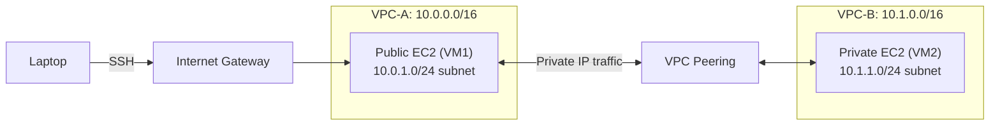

# AWS VPC Peering Project

**Goal:** Connect a public EC2 instance in VPC-A to a private EC2 instance in VPC-B using VPC Peering and Terraform.

## Architecture



| Setting | VPC-A | VPC-B |
|---|---|---|
| CIDR | `10.0.0.0/16` | `10.1.0.0/16` |
| Subnet | `10.0.1.0/24` (public) | `10.1.1.0/24` (private) |
| EC2 | VM1, public IP | VM2, private IP only |
| Peering route | `10.1.0.0/16 → pcx` | `10.0.0.0/16 → pcx` |
| Internet route | `0.0.0.0/0 → IGW` | None |

## VPC Peering Conditions

| Condition | Requirement | Example |
|---|---|---|
| CIDR ranges | VPC CIDRs must not overlap (IPv4 or IPv6). | ✅ `10.0.0.0/16 ↔ 10.1.0.0/16`; ❌ `10.0.0.0/16 ↔ 10.0.1.0/24` |
| Peering status | Request accepted; status `active`. | `pending-acceptance → active` |
| Route tables | Each side needs a route to the peer CIDR via its peering ID. | VPC-A: `10.1.0.0/16 → pcx-xxxx`; VPC-B: `10.0.0.0/16 → pcx-xxxx` |
| Security groups | Permit only required protocols and sources. | VM2 inbound SSH TCP 22 and ICMP from VM1 private IP `10.0.1.10/32` |
| Network ACLs | Permit requests and return traffic in both directions. | Allow TCP 22 to VM2 and ephemeral response ports back to VM1 |
| DNS | Optional for private-IP tests; enable DNS resolution options for peer public hostnames to resolve privately. | `ping 10.1.1.10` needs no DNS setting |
| Regions/accounts | Same or different AWS regions/accounts supported. | `us-east-1 ↔ us-west-2` or Account A ↔ B |
| Transitive routing | Peering does not provide transit through a third VPC. | A ↔ B and B ↔ C does **not** allow A ↔ C |
| Internet/NAT sharing | Cannot use the peer's IGW or NAT Gateway through peering. | Private VM2 cannot reach the internet via VPC-A's IGW |
| Peering quotas | Subject to AWS VPC peering quotas. | Check **Service Quotas → VPC peering connections per VPC** |

## Prerequisites

AWS CLI configured, Terraform 1.5+, SSH, AWS permissions, and your public IPv4 address.

## Deploy

```bash
git clone https://github.com/atulkamble/aws-vpc-peering.git
cd aws-vpc-peering/terraform

aws sts get-caller-identity
terraform init
terraform fmt -check
terraform validate

export ADMIN_CIDR="YOUR_PUBLIC_IP/32"
terraform plan -var="admin_cidr=$ADMIN_CIDR"
terraform apply -var="admin_cidr=$ADMIN_CIDR"
```

Replace `YOUR_PUBLIC_IP` with your public IPv4 address.

## Verify

```bash
terraform output
aws ec2 describe-vpc-peering-connections \
  --vpc-peering-connection-ids "$(terraform output -raw peering_connection_id)" \
  --query 'VpcPeeringConnections[*].Status.Code'
```

Expected peering status: `active`.

## Test Connectivity

```bash
chmod 400 key.pem
VM1_PUBLIC=$(terraform output -raw vm1_public_ip)
VM2_PRIVATE=$(terraform output -raw vm2_private_ip)

# SSH to public VM1
ssh -i key.pem ec2-user@"$VM1_PUBLIC"

# Ping VM2 through VM1 (run from laptop)
ssh -i key.pem ec2-user@"$VM1_PUBLIC" "ping -c 3 $VM2_PRIVATE"

# SSH to private VM2 through VM1 (run from laptop)
ssh -i key.pem -o IdentitiesOnly=yes \
  -o "ProxyCommand=ssh -i key.pem -o IdentitiesOnly=yes -W %h:%p ec2-user@$VM1_PUBLIC" \
  ec2-user@"$VM2_PRIVATE"
```

Exit the first SSH session before running the remaining commands on your laptop.

## Cleanup

```bash
terraform destroy -var="admin_cidr=$ADMIN_CIDR"
```

## Key Points

- VPC CIDRs must not overlap; peering must be active.
- Both route tables and security rules must allow private traffic.
- VPC peering is **not transitive**.
- VM2 has no direct internet access in this lab.
- **Security:** Do not commit `key.pem` or Terraform state; private keys are stored in state.
- **Costs:** EC2 and public IPv4 charges may apply.

**Source:** [Terraform files](terraform/) · [AWS VPC Peering documentation](https://docs.aws.amazon.com/vpc/latest/peering/what-is-vpc-peering.html)
