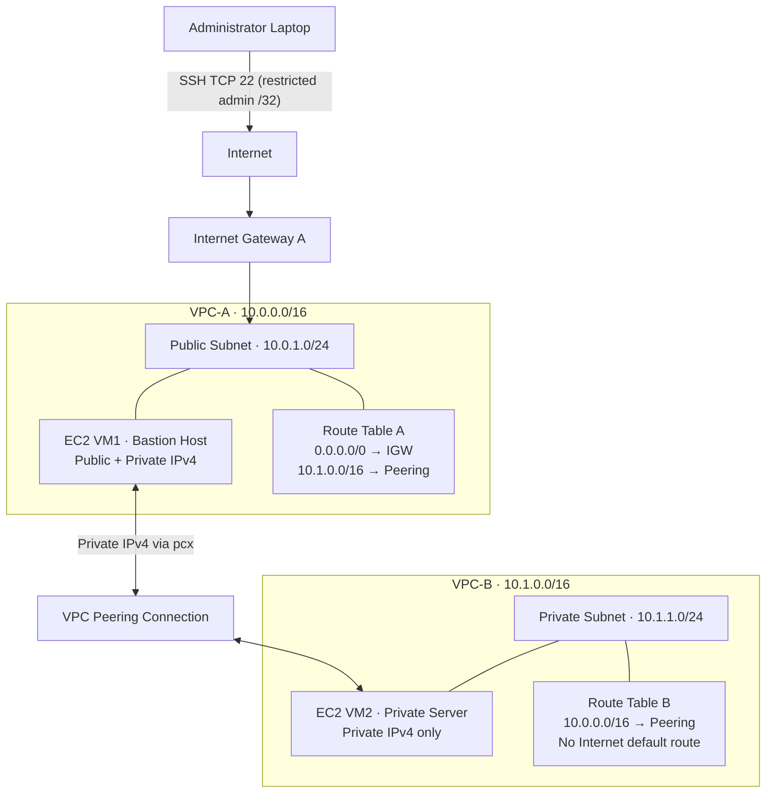
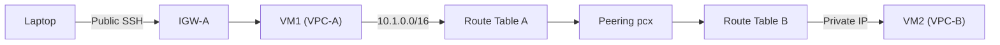

# AWS VPC Peering — Hands-on Project

Connect two AWS VPCs privately using **VPC Peering**, **EC2**, and **Terraform**.

> **Learning objective:** Access a private EC2 instance in VPC-B from a public EC2 jump host in VPC-A, using private IP networking.

## 1. Architecture

### Network architecture (Mermaid)



### Traffic flow



**Key points:** Only VM1 has a public IPv4 address. VM2 is private and has no direct Internet Gateway or NAT route. VPC peering carries **private traffic** between the VPCs; the Internet Gateway is used only for reaching VM1 from the administrator's laptop. Route tables, security groups, and network ACLs must allow the traffic.

## 2. Resources Created

| Resource | VPC-A | VPC-B |
|---|---|---|
| VPC CIDR | `10.0.0.0/16` | `10.1.0.0/16` |
| Subnet CIDR | `10.0.1.0/24` | `10.1.1.0/24` |
| EC2 | VM1 (public bastion) | VM2 (private server) |
| Public IP | Yes | No |
| Internet Gateway | Yes | No |
| Route to peer | `10.1.0.0/16 → pcx` | `10.0.0.0/16 → pcx` |
| Default internet route | `0.0.0.0/0 → IGW` | None |

## 3. Prerequisites

- AWS account with EC2/VPC permissions.
- AWS CLI configured (`aws configure` or an existing AWS profile).
- Terraform 1.5+ and SSH installed.
- Your **public IPv4 address/32** for secure SSH access.
- Default region: `us-east-1`; default AZ: `us-east-1a`.
- A unique EC2 key-pair name (default: `vpc-peering-lab-key`).

## 4. Deploy with Terraform

**Step 1 — Clone the project**

```bash
git clone https://github.com/atulkamble/aws-vpc-peering.git
cd aws-vpc-peering/terraform
```

**Step 2 — Check prerequisites**

```bash
aws sts get-caller-identity
terraform version
```

**Step 3 — Initialize and validate**

```bash
terraform init
terraform fmt -check
terraform validate
```

**Step 4 — Set your public IPv4 address**

Replace `YOUR_PUBLIC_IP` with your actual public IPv4 address. Example format: `203.0.113.10/32` (documentation example only).

```bash
export ADMIN_CIDR="YOUR_PUBLIC_IP/32"
```

**Step 5 — Plan and apply**

```bash
terraform plan -var="admin_cidr=$ADMIN_CIDR"
terraform apply -var="admin_cidr=$ADMIN_CIDR"
```

Type `yes` when prompted. AWS may charge for EC2 instances and public IPv4 addresses.

## 5. Verify Infrastructure

```bash
terraform output
```

Expected outputs include `vm1_public_ip`, `vm1_private_ip`, `vm2_private_ip`, `peering_connection_id`, and route-table IDs.

**Check peering status**

```bash
aws ec2 describe-vpc-peering-connections \
  --vpc-peering-connection-ids "$(terraform output -raw peering_connection_id)" \
  --query 'VpcPeeringConnections[*].Status.Code'
```

Expected: `active`.

**Check routes on both sides**

```bash
aws ec2 describe-route-tables \
  --route-table-ids "$(terraform output -raw route_table_a_id)" "$(terraform output -raw route_table_b_id)" \
  --query 'RouteTables[*].Routes[*].{Destination:DestinationCidrBlock,Gateway:GatewayId,Peering:VpcPeeringConnectionId}' \
  --output json
```

## 6. Test Private Connectivity

Run from the **terraform directory** on your laptop:

```bash
chmod 400 key.pem
VM1_PUBLIC=$(terraform output -raw vm1_public_ip)
VM2_PRIVATE=$(terraform output -raw vm2_private_ip)
```

**Test A — SSH to public VM1**

```bash
ssh -i key.pem ec2-user@"$VM1_PUBLIC"
```

Exit VM1 with `exit`.

**Test B — Ping private VM2 from VM1**

```bash
ssh -i key.pem ec2-user@"$VM1_PUBLIC" "ping -c 3 $VM2_PRIVATE"
```

Expected: Ping replies with 0% packet loss, assuming the instances and network rules are healthy.

**Test C — SSH to private VM2 through VM1**

```bash
ssh -i key.pem -o IdentitiesOnly=yes \
  -o "ProxyCommand=ssh -i key.pem -o IdentitiesOnly=yes -W %h:%p ec2-user@$VM1_PUBLIC" \
  ec2-user@"$VM2_PRIVATE"
```

Expected: An SSH shell on VM2. This approach **does not copy the private key to VM1**.

## 7. Troubleshooting

| Problem | What to check |
|---|---|
| `Permission denied (publickey)` | Correct `key.pem`, permissions (`chmod 400`), `ec2-user` |
| SSH to VM1 times out | Your `ADMIN_CIDR`, VM1 public IP, IGW route, security group |
| VM1 cannot ping VM2 | Peering is `active`, both routes, ICMP security rules, NACLs |
| VM2 SSH times out | VM2 security group TCP 22 from VPC-A, routing, NACLs |
| VM2 has no internet | Expected: VPC-B has no NAT/IGW route |

## 8. Cleanup

From the `terraform` directory:

```bash
terraform destroy -var="admin_cidr=$ADMIN_CIDR"
```

Type `yes` to confirm. Check that resources have been removed to avoid ongoing charges.

## 9. Points to Remember

1. VPC CIDR ranges must **not overlap**.
2. Peering must be **active**.
3. Add routes in **both VPCs**.
4. Security groups and NACLs must permit required traffic.
5. VPC peering does **not** provide transitive routing.
6. VPC peering can connect VPCs across accounts and Regions.
7. Peering does not provide internet access through another VPC's Internet Gateway.

**Security note:** The lab creates an SSH private key in `terraform/key.pem` and Terraform state. Do not commit or share either. Use secure state storage and managed access methods for production.

## 10. More Information

- [Terraform source code](terraform/)
- [VPC Peering requirements](requirements.md)
- [VPC fundamentals](vpc.md)
- [Historical connectivity test results](terraform/connectivity-test-results.md) — previous test, **not** verification of this updated version
- [AWS VPC Peering documentation](https://docs.aws.amazon.com/vpc/latest/peering/what-is-vpc-peering.html)

---

**Author:** [Atul Kamble](https://github.com/atulkamble)
